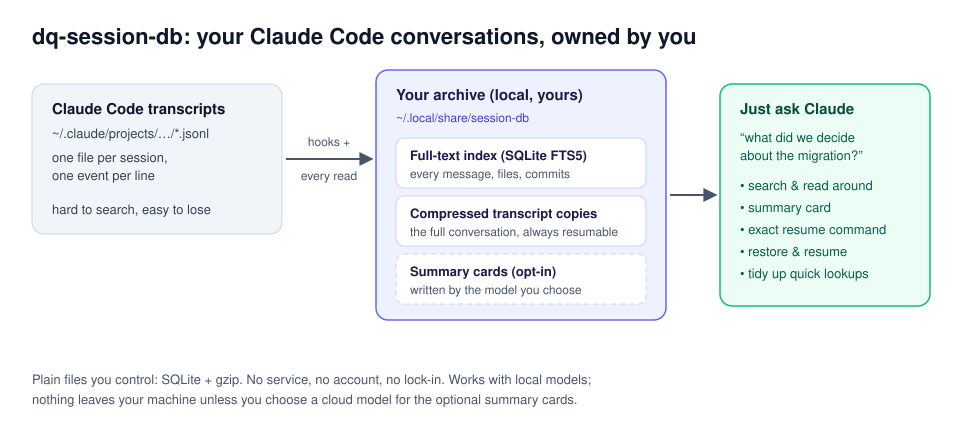
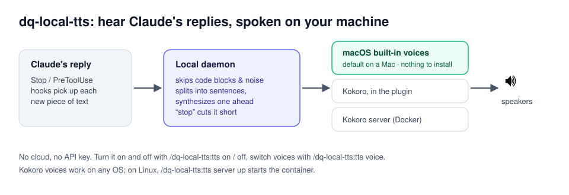

# DevQuasar skills

Free, local-first plugins for Claude Code, by [DevQuasar](https://devquasar.com).
Everything here runs on your machine. DQ = DevQuasar.

```
/plugin marketplace add devquasar-ai/skills
/plugin install dq-session-db@devquasar
/plugin install dq-local-tts@devquasar
```

## dq-session-db: your Claude Code history, kept and searchable



Claude Code deletes your session transcripts after 30 days, and even before that, finding
"the session where we decided X" means grepping JSON files. dq-session-db keeps every
conversation in a local, searchable archive, with a compressed copy of each transcript, so you
can:

- **ask Claude about past work**: "what did we decide about the migration?", "where did I leave
  off on the billing service?" It finds the session, reads the relevant part, and answers with
  the source.
- **resume any session**: it gives you the exact `cd … && claude --resume …` command, and can put
  back a transcript Claude Code already deleted.
- **see what a session did**: files written and commits made, plus an optional summary card
  written by a model you choose (Haiku via your Claude login, or a local model).
- **keep it tidy**: quick "find that session" lookups are left out of results, and a cleanup
  command hides or removes them.

Stdlib Python and SQLite: no packages, no cloud. [Details →](plugins/dq-session-db/)

## dq-local-tts: hear Claude's replies



Listen to Claude while you look at something else. Replies are spoken as they arrive, code
blocks and noise skipped, one sentence ahead so there are no gaps. On a Mac it works right away
with the built-in voices; Kokoro's natural voices are a switch away on any OS. No cloud, no API
key. [Details →](plugins/dq-local-tts/)

## Other agents

The skills use the open [Agent Skills](https://agentskills.io) format (`SKILL.md`). The packaging
here (hooks, slash commands, the marketplace) is Claude Code's. session-db's command-line tool runs
anywhere Python does, but today it reads Claude Code's transcripts.

**Using Claude Code with a local model?** Call skills directly (e.g.
`/dq-session-db:sessions <question>`): smaller models often don't pick up skills on their own.

## More from DevQuasar

- 🤗 [huggingface.co/DevQuasar](https://huggingface.co/DevQuasar): 900+ quantized open-weight models
- 📝 [devquasar.com](https://devquasar.com): hands-on posts on local AI, hardware and models

MIT license. Issues and pull requests welcome.
