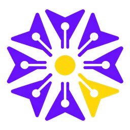

<p align="center"></p>

# DQ Plugin Vault

Free, local-first plugins for Claude Code, by [DevQuasar](https://devquasar.com).
Everything here runs on your machine. DQ = DevQuasar. Project page:
[devquasar.com/dq-plugin-vault](https://devquasar.com/dq-plugin-vault/)

## Add the marketplace

```
/plugin marketplace add devquasar-ai/dq-plugin-vault
```

Then install the plugins you want from `/plugin`, or with the install line on each plugin's page.

## Plugins

| Plugin | What it does |
|---|---|
| [dq-session-db](plugins/dq-session-db/) | Your Claude Code history, kept and searchable: ask about past sessions, resume them, even after Claude Code deletes them. |
| [dq-local-tts](plugins/dq-local-tts/) | Hear Claude's replies, spoken on your machine: macOS voices out of the box, Kokoro on any OS. With macOS Dictation, a full voice conversation that stays local. |

## Notes

- **Local models:** if you run Claude Code with a local model, call skills directly (for example
  `/dq-session-db:sessions <question>`): smaller models often don't pick them up on their own.
- **Other agents:** the skills use the open [Agent Skills](https://agentskills.io) format
  (`SKILL.md`); the packaging (hooks, slash commands, marketplace) is Claude Code's.

## More from DevQuasar

- 🤗 [huggingface.co/DevQuasar](https://huggingface.co/DevQuasar): 900+ quantized open-weight models
- 📝 [devquasar.com](https://devquasar.com): hands-on posts on local AI, hardware and models

## Support

These plugins are free, and so are the 900+ models on Hugging Face. Building and testing them
takes real hardware and time. If they save you some, you can support the work here:

<a href='https://ko-fi.com/L4L416YX7C' target='_blank'></a>

MIT license. Issues and pull requests welcome.
